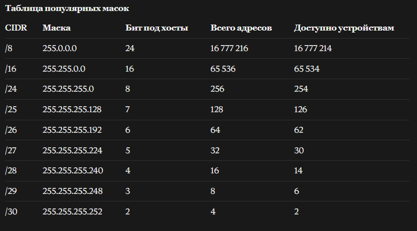
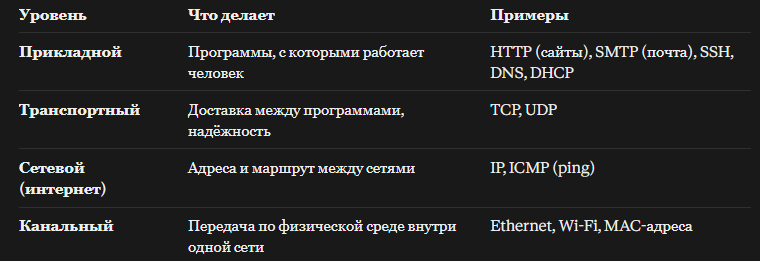
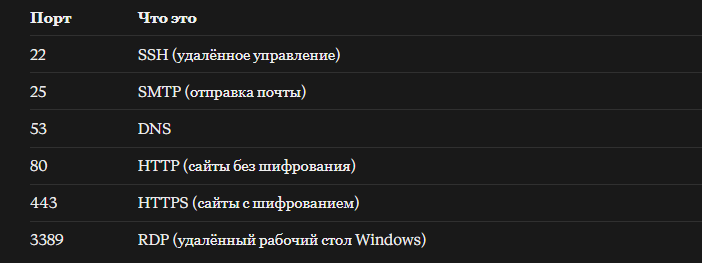

### TCP/IP
Своими словами - протокол, с помощью которого устройства обмениваются пакетамии с информацией в сети.  
Нормальными словами; TCP/IP это набор правил (протоколов) по которым устройства общаются в сети: Компы телефоны серверы, роутеры. Интернет работает именно на нем.  
Название составлено из двух глвных протоколов: 
- IP (Internet Protocol) отвечает за адресацию и доставку. Куда отправлять данные.  
-  TCP (Transmission Internet Protocol) Отвечает за надежность, чтобы данные приходили в полном объеме и в правильном порядке.     
  ### IP
internet protocol Это адрес устройства в сети, по которому данные находят получателя. Есть два вида IP адресов 
- IPv4 - состоит из 4-х чисел, разделенных точками, например 
- -  192.168.0.1
8.8.8.8
172.16.254.1
- IPv6 аписывается в шестнадцатеричном виде, адресов в нём почти неограниченно много: 2001:0db8:85a3:0000:0000:8a2e:0370:7334
::1
### DNS
Domen Name System - Обозначение IP Адреса буквами, для удобства. Типа Google.com итп 
### Маска подсети и шлюз по умолчанию 
Маска подсети помогает определить какая часть в IP адресе относится к сети а какая к устройству(хосту)  

Маска подсети это число которое говорит сколко бит в начале адреса относятся к сети, после чего идет номер устройства.  

В адресе 32 бита. Вот эти ебаные 4 числа через точку называются октета(8 бит). Вот как раз эти биты могут быть нулем или единицей. Эти биты внутри имеют цифру которая че значит я не ебу. Они идут по порядку типа 2в7 степени, 2в6 ... 2в0. И выходит 128 64 32 итп
И Например если маска подсети это 255.255.255.0 В битах это 11111111.11111111.11111111.00000000 оно либо пишется как выше, либо /24 что значит 24 единицы. Получается что вот эти единицы (или первые 3 октета) это сеть, А последние 8 бит или один октет это номер устройства. 

Есть две формы записи маски подсети  
Десятичная это 255.255.255.0  
CIDR запись. Например /24  

Важно знать: Например у нас айпишник 192.168.1.2/24 получается что первые три океты это сеть, а последняя октета это номер устройства. В этом айпишнишнике бцдет свободно не 256 апйи адресов, а 254. Потому что адрес 192.168.1.0 это будет адрес самой сети. а 192.168.1.255 адрес сразу всех хостов, его используют как широковещательный broadcast адрес, с помощью которого можно отправлять данные сразу всем. 

  Как устроено TCP IP: 4 уровня   
   
Теперь на примере:   

1. Я гуглю смешныесиськи.com. Через DNS (прикладной уровень) компьютер узнает айпишник сайта например 93.184.216.43.  
2. Браузер форматирует запрос по протоколу HTTP типа дай мне главную страницу  
3. TCP (транспортный уровень) режет данные на кусочки, нумерует их и устанавливает соединение с сервером.  
4. IP (сетевой уровень) добавляет к каждому кусочку адрес отправителя и получателя. Теперь это пакет.  
5. Пакет уходит через сетевую карту или WIFI (канальный уровень) к роутеру и идет по цепочке роутеров провайдера до сервера, который дает ответ
6. Сервер делает все тоже самое только в обратную сторону и присылает страницу. 
### Порт 
Ip адрес указывает на компьютер, а порт на конкретную программу на нем. На одном сервере могут одновременно работать сайт, почта и SSH, и порты их различают. 
 

 Как TCP обеспечивает надежность 
- Трехстороннее рукопожатие: перед передачей стороны договорариваются о соединении. Клиент говорит Привет хочу соединиться (SYN), сервер отвечает Привет согласен (SYN-ACK), клиент подтверждает Супер, начинаем (ACK) 
- Нумерация и подтверждение. Клиент подтверждает что получил пакет. Если нет подтверждения пакет отправляется заново.

- Контроль скорости. Если получатель не успевает, TCP притормаживает отправку. 

### UDP 
Это такой набор протоколов, Который клал хуй на проверку доставки пакетов, дошло и круто, не дошло да и пофик. Зато он быстрее TCP. Его используют там, где больше важная скорость, а не надежность доставки всех пакетов. ИСпользуют например на стримах и в видеозвонках.